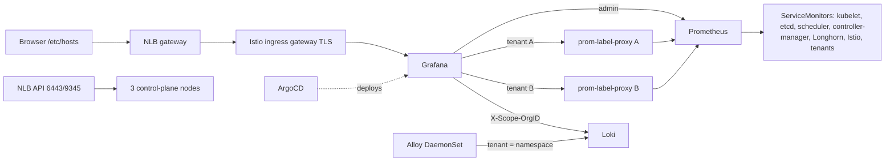

# Plan: Multi-tenant monitoring on RKE2 (AWS, CIS) deployed by ArgoCD

Repository: `git@github.com:shahgnp/monitoring-via-gitops.git` (branch `main`)

## 1. Goal

Build, from this repo alone, an on-prem-like Kubernetes cluster on AWS and a GitOps-managed monitoring platform on top of it:

- RKE2 `v1.37.1+rke2r1` (latest release, verified), CIS profile enabled, 3 control-plane + 3 worker nodes.
- ArgoCD (new instance on the new cluster) deploys everything else.
- Metrics: Prometheus. Logs: Loki + Grafana Alloy. Dashboards: Grafana.
- Multi-tenancy: tenant users see only their own namespace's metrics and logs; the admin sees everything.
- Two demo applications (`tenant-a`, `tenant-b`) acting as separate tenants.
- The user verifies the result after implementation.

## 2. Decisions and inputs

| Topic | Decision |
|---|---|
| Region / AZ | `us-east-1`, single AZ (`us-east-1a`) to avoid cross-AZ cost |
| OS | Ubuntu 24.04 LTS (amd64), resolved via the Canonical SSM parameter |
| Instances | Control plane: 3 x `t3.medium`, 40 GiB gp3. Workers: 3 x `t3.large`, 60 GiB gp3 |
| Network | One VPC, one public subnet, no NAT gateway (cost). Nodes get public IPs |
| Network access | Security groups open to `0.0.0.0/0` for SSH, 6443 and gateway ports, as requested. Exposed as a variable `allowed_cidr` so it can be narrowed later |
| SSH key | New key `~/.ssh/monitoring-poc-ed25519` generated locally; existing keys are never overwritten or deleted |
| CNI | Calico (`cni: calico`) |
| CIS | RKE2 `profile: cis` (PSA `restricted` everywhere except `kube-system`) |
| Control-plane HA | Terraform-managed NLB (6443, 9345) is the real endpoint. kube-vip static pods are deployed as requested, but a kube-vip ARP VIP is not reachable inside a VPC and is not used |
| Cloud integration | `cloud-provider-name: external` + aws-cloud-controller-manager (Service type `LoadBalancer`) |
| ArgoCD | New instance installed on the new cluster |
| Repo access for ArgoCD | The token in `../token-monitoring-via-gitops` (outside the repo) is the repository credential ArgoCD uses to read this private repo. Applications and the repo Secret use the HTTPS URL `https://github.com/shahgnp/monitoring-via-gitops.git`, because a token cannot authenticate over SSH. The token is read from the file by `scripts/post-install.sh` and never committed or printed |
| Storage | Longhorn (default StorageClass), 2 replicas. No object storage; Loki uses filesystem storage on Longhorn |
| TLS | Self-signed CA via cert-manager. Host name `grafana.poc.local`, resolved by editing `/etc/hosts` |
| Secrets | No secret management. PoC credentials are plaintext in the repo and called out in the README |
| Scale | Minimal log volume; 7-day retention for metrics and logs |
| Tenant metric isolation | `prom-label-proxy` per tenant (namespace label enforced) |
| Tenant log isolation | Loki `auth_enabled: true`, tenant ID = namespace, `X-Scope-OrgID` set in the tenant's Grafana datasource |
| Tenant UI isolation | One Grafana org per tenant; tenant users are Viewers in their org only |

Assumptions to confirm if wrong: single namespace per tenant; one AWS account (root credentials currently used for the CLI session, which is not recommended); Terraform state is local and git-ignored.

## 3. Architecture



## 4. Repository layout

```
monitoring-via-gitops/
  PLAN.md
  README.md                      # how to deploy, access, credentials, teardown
  .gitignore                     # *.tfstate, .terraform/, *.tfvars, tokens, kubeconfig
  infra/terraform/
    versions.tf variables.tf network.tf security.tf iam.tf
    compute.tf nlb.tf keypair.tf outputs.tf
    templates/
      server-first.sh.tftpl      # first control-plane cloud-init
      server-join.sh.tftpl       # other control-plane nodes
      agent.sh.tftpl             # workers
      rke2-config-*.yaml.tftpl
      kube-vip.yaml.tftpl
      manifests/                 # RKE2 HelmChart: aws-ccm, argocd
  scripts/
    gen-ssh-keys.sh              # creates the node SSH key if absent
    post-install.sh              # kubeconfig fetch, repo secret from token file, root app
  bootstrap/
    root-app.yaml                # app-of-apps
    repo-secret.example.yaml
  apps/                          # one ArgoCD Application per component (sync waves)
  platform/                      # per-component values and manifests
    cert-manager/ longhorn/ istio/ gateway/ monitoring/ loki/ alloy/
    reconciler/ kube-system-netpol/
  charts/
    tenant/                      # namespace, proxy, netpol, alert config, registry Secret
    demo-app/                    # nginx-unprivileged + exporter + traffic generator
    reconciler/                  # Grafana org/user/datasource reconciler CronJob
  appsets/
    tenants.yaml demo-apps.yaml
  tenants/
    tenant-a/values.yaml
    tenant-b/values.yaml
```

## 5. Phases

### Phase 0: Local prerequisites
1. Verify tools: `terraform`, `aws`, `kubectl`, `helm`, `jq`, `ssh`. Install what is missing after confirming with the user.
2. `aws sts get-caller-identity` confirms the session (currently root; recommend an IAM identity).
3. Generate the EC2 SSH key `~/.ssh/monitoring-poc-ed25519` if absent, never overwriting existing keys.
4. Confirm the token in `../token-monitoring-via-gitops` is a GitHub token with read access to this repo (fine-grained: Contents read-only; classic: `repo`). No deploy key is needed.
5. Add `.gitignore` before the first commit so state, keys, kubeconfig and token files are never committed. The token already lives outside the repo directory; the ignore rule is an extra safeguard.

### Phase 1: Terraform infrastructure (`infra/terraform`)
1. Provider `aws` (`us-east-1`), `random` and `tls` as needed; local state.
2. Network: VPC, internet gateway, one public subnet, route table. Subnet and instance tags `kubernetes.io/cluster/<name>`; subnet tag `kubernetes.io/role/elb=1`.
3. Security groups: all traffic inside the cluster group; SSH, 6443, 9345 and NodePort range for the gateway from `allowed_cidr` (default `0.0.0.0/0`).
4. IAM: instance profiles for control-plane and workers with the permissions the aws-cloud-controller-manager needs.
5. Key pair resource imports the new public key.
6. Generate a random RKE2 join token.
7. Compute: 3 control-plane and 3 worker instances using templated cloud-init (`user_data`).
8. API NLB: TCP 6443 and 9345, target type `ip` with client-IP preservation off, so nodes can reach the API through the NLB without hairpin failures.
9. Outputs: NLB DNS name, node IPs, SSH command, kubeconfig fetch command.

### Phase 2: Node bootstrap (cloud-init)
All nodes:
- Install `open-iscsi`, `nfs-common`; enable `iscsid` (Longhorn).
- Install RKE2 `v1.37.1+rke2r1` (tarball method).
- CIS host prerequisites: create the `etcd` user and group, copy `rke2-cis-sysctl.conf` to `/etc/sysctl.d/60-rke2-cis.conf` and apply it **before** RKE2 starts.

Servers (`/etc/rancher/rke2/config.yaml`):
- `profile: cis`, `cni: calico`, `token`, `tls-san` (NLB DNS name and kube-vip address).
- `cloud-provider-name: external`.
- `disable: [rke2-ingress-nginx, rke2-traefik]` (Istio is the gateway).
- `etcd-expose-metrics: true`.
- `kube-controller-manager-arg: [bind-address=0.0.0.0]`, `kube-scheduler-arg: [bind-address=0.0.0.0]`, `kube-proxy-arg: [metrics-bind-address=0.0.0.0:10249]` so Prometheus can scrape them.
- First server bootstraps; other servers and agents join through the NLB.

First server only:
- `/var/lib/rancher/rke2/server/manifests/`: HelmChart manifests for the AWS cloud-controller-manager and ArgoCD. The cloud controller comes first because nodes stay tainted until it runs.
- kube-vip static pod manifest on servers (ARP, cosmetic on AWS).

### Phase 3: Cluster access and ArgoCD bootstrap (`scripts/post-install.sh`)
1. Fetch `rke2.yaml` from the first server, rewrite the server address to the NLB DNS name, and store it locally (git-ignored).
2. Wait for 6 Ready nodes and for ArgoCD.
3. Create the ArgoCD repository Secret (HTTPS URL, username, and the token read from `../token-monitoring-via-gitops`). The token is passed straight to `kubectl` and never written to the repo or echoed.
4. Apply `bootstrap/root-app.yaml` (app-of-apps pointing at the HTTPS repo URL, `apps/`, revision `main`).
5. Print the initial ArgoCD admin password and access instructions (`kubectl port-forward`).

### Phase 4: Platform applications (`apps/`, sync waves)
| Wave | Application | Notes |
|---|---|---|
| -2 | cert-manager | CRDs enabled; self-signed `ClusterIssuer` and CA |
| -2 | Longhorn | `longhorn-system` namespace labeled PSA `privileged`; 2 replicas; default StorageClass |
| -1 | Istio base, istiod | Namespaces labeled PSA `baseline`/`privileged` as required; no sidecars in tenant namespaces |
| 0 | kube-prometheus-stack | Bundled Grafana; `monitoring` namespace PSA `privileged` for node-exporter |
| 0 | Loki | SingleBinary, filesystem on Longhorn, `auth_enabled: true`, `multi_tenant_queries_enabled: true`, 7d retention |
| 1 | Alloy | DaemonSet; `loki.source.kubernetes` (no hostPath, PSA-safe); `stage.tenant` from namespace |
| 1 | Istio gateway + Grafana exposure | `LoadBalancer` Service with NLB annotation; `Gateway`, `VirtualService`, `Certificate` for `grafana.poc.local` |
| 2 | Reconciler | CronJob that syncs Grafana orgs, users, datasources, dashboards |
| 3 | Tenant and demo ApplicationSets | One generated Application per `tenants/*` directory |

All apps use multi-source (upstream chart plus `$values` from this repo), `ServerSideApply` for CRD-heavy charts, and retry with backoff. Chart and image versions are pinned after verifying current releases during implementation.

### Phase 5: Monitoring details
- Prometheus: 7d retention, Longhorn PVC (about 15 GiB), selects ServiceMonitors, PodMonitors and rules from all namespaces.
- RKE2 control-plane scraping: kubeEtcd, kubeScheduler, kubeControllerManager, kubeProxy configured for the RKE2 ports and endpoints.
- Extra ServiceMonitors: Longhorn, Istio, ArgoCD.
- NetworkPolicy in `kube-system` allowing Prometheus to scrape coredns metrics (the CIS-applied policy there allows only same-namespace traffic).
- Alertmanager with a Longhorn PVC; tenant `AlertmanagerConfig` scoped to the tenant namespace (null receiver in the PoC).
- Grafana: `auto_assign_org=false`, org creation disabled, anonymous access off, `root_url` = `https://grafana.poc.local`.

### Phase 6: Tenancy
Tenant onboarding is a directory under `tenants/` with a `values.yaml` (tenant name, namespace, Grafana user, password).

`charts/tenant` renders:
- Namespace with PSA `restricted`, a `tenant` label, default ServiceAccount token auto-mount off.
- Default-deny ingress NetworkPolicy; allow Prometheus scraping from `monitoring`.
- `prom-label-proxy` Deployment and Service with `namespace=<tenant ns>` enforced.
- Demo `PrometheusRule` and `AlertmanagerConfig`.
- Registry Secret (labeled) read by the reconciler.

`charts/reconciler` (CronJob, `curl` + `jq`):
1. Creates the Grafana org, the user (Viewer in that org only, removed from org 1).
2. Creates read-only datasources: Prometheus via the tenant proxy, Loki with `X-Scope-OrgID=<namespace>`.
3. Imports a tenant overview dashboard (request rate, CPU/memory, logs).
4. Maintains an admin Loki datasource in org 1 with a multi-tenant header listing all namespaces.

`charts/demo-app` (deployed per tenant by a second ApplicationSet):
- nginx-unprivileged with `stub_status`, metrics exporter sidecar, `ServiceMonitor`.
- Traffic generator so metrics and logs appear immediately.
- PSA `restricted` compatible (non-root, read-only filesystem where possible, seccomp).

### Phase 7: Documentation and delivery
1. README: prerequisites, `terraform apply`, post-install script, `/etc/hosts` entry, credentials table, how to add a tenant, teardown.
2. Commit in logical steps and push to `main` over SSH.
3. Ask for explicit confirmation before `terraform apply` and before `terraform destroy`.

## 6. Verification checklist (run after deployment)

Infrastructure and cluster
- [ ] `kubectl get nodes` shows 6 Ready nodes on `v1.37.1+rke2r1`.
- [ ] RKE2 config shows `profile: cis`; etcd runs as the `etcd` user.
- [ ] aws-cloud-controller-manager running; nodes have `providerID`.

GitOps
- [ ] All ArgoCD Applications are Synced and Healthy.
- [ ] Adding `tenants/tenant-c/values.yaml` and pushing creates a working third tenant with no manual step.

Monitoring
- [ ] Prometheus targets up: kubelet, etcd, scheduler, controller-manager, kube-proxy, Longhorn, Istio, demo apps.
- [ ] Loki receives logs per tenant ID; no logs accepted without a tenant header.

Access and isolation
- [ ] `https://grafana.poc.local` reachable after the `/etc/hosts` entry (browser warns about the self-signed certificate).
- [ ] Admin sees all namespaces in Prometheus and Loki.
- [ ] `tenant-a` user sees only `tenant-a` metrics and logs; querying `tenant-b` returns nothing.
- [ ] Tenant users cannot edit datasources or see other orgs.

## 7. Risks and caveats

1. **Open security groups**: SSH and API are open to the internet as requested. Combine with the generated key and CIS profile, but narrow `allowed_cidr` when possible.
2. **Root credentials**: avoid root for day-to-day use; never create root access keys.
3. **kube-vip on AWS**: deployed but not functional; the NLB is the real endpoint.
4. **Memory**: 8 GiB workers are tight for Prometheus, Loki, Longhorn, Istio and ArgoCD. If pods are evicted, move to `t3.xlarge`.
5. **Plaintext credentials**: Grafana admin and tenant passwords, and the RKE2 token (in EC2 user data and local Terraform state), are not protected. Acceptable only for this PoC. The GitHub token is stored as a Secret in the `argocd` namespace; use a read-only token.
6. **Label-proxy limits**: isolation holds only for queries through the proxy; tenants must have no direct Prometheus access (enforced by NetworkPolicy and Grafana-only access).
7. **CIS vs. components**: node-exporter, Longhorn and Istio namespaces need relaxed PSA labels; this is intentional and documented.
8. **Cost**: 6 EC2 instances, gp3 volumes and two NLBs accrue cost until `terraform destroy`.

## 8. Teardown

1. Delete the gateway Service (removes the AWS-created NLB) via ArgoCD or `kubectl`.
2. `terraform destroy` in `infra/terraform`.
3. Remove local kubeconfig; optionally remove the generated SSH key. Revoke the GitHub token if it is no longer needed.
